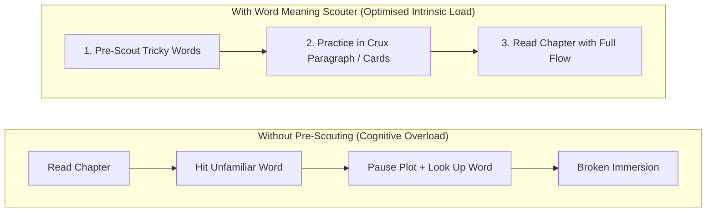
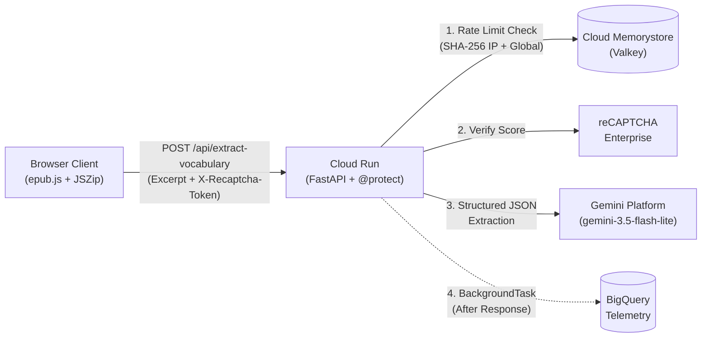

# Word Meaning Scouter

Pre-reading vocabulary extractor for EPUB books—grounded in **Cognitive Load Theory** and engineered as a public, zero-login AI web application on **Google Cloud**.

**Live App:** [https://word-meaning-scouter.com](https://word-meaning-scouter.com)

---

## Why This App Exists (Cognitive Load Theory)

When you hit an unfamiliar word mid-sentence in a dense book, your working memory is forced to do two things at once: decode lexical meaning and track the narrative thread. That context switch creates **cognitive overload** and breaks reading immersion.

**Word Meaning Scouter** separates vocabulary acquisition from reading the story:
1. **Client-Side EPUB Parsing:** Drop any `.epub` file into the browser (`epub.js` + `JSZip`). The book never leaves your device; only the selected chapter or page-range excerpt is sent for analysis.
2. **Pre-Reading Vocabulary Grid:** Extracts the 4, 8, 16, or 32 trickiest words in the section—complete with phonetic pronunciation, part of speech, spoiler-free lexical definitions, and usage examples.
3. **Spoiler-Free Crux Paragraph:** Optionally synthesizes a short, self-contained passage that weaves together every extracted word so you can practice seeing them in context before starting the chapter.
4. **Printable Flashcards:** Generates single-sided (foldable) or double-sided (duplex) print sheets that double as physical bookmarks.



---

## Why Google Cloud? (The Architecture Story)

Putting a generative AI endpoint on the public internet without a login wall is a classic developer dilemma: **how do you keep the user experience frictionless while protecting your cloud bill and backend from bots, traffic spikes, and prompt injection?**

This project answers that question with a cohesive Google Cloud stack:



### Why Gemini platform?
- **Right-Sized Speed & Capability (`gemini-3.5-flash-lite`):** Identifying tricky vocabulary, defining words, and synthesizing a short passage is a relatively straightforward extraction and text-generation task—`gemini-3.5-flash-lite` is more than capable of handling it accurately while delivering ultra-fast, low-cost responses for an interactive reader workflow.
- **Native Structured Outputs:** Instead of fragile regex parsing, the backend passes a strict schema (`VocabularyExtractionResponse`) directly to Gemini platform so the model is constrained to return valid, typed JSON every time.
- **Keyless IAM Authentication:** Running on the Gemini platform uses Application Default Credentials so that there are no static LLM API keys to rotate or leak.
- **Prompt-Injection Isolation:** Untrusted book text is isolated inside `<book_excerpt>` delimiters with system instructions that ignore embedded directives / prompt injections.

### Why Cloud Run?
- **Scale-to-Zero Economics:** A public app shouldn't cost money when nobody is reading, yet needs to scale horizontally in seconds to meet sudden demand.
- **Single-Artifact Simplicity:** One container serves both the FastAPI backend and the static frontend, with automatic TLS and custom domain mapping.
- **Direct VPC Egress:** Cloud Run connects directly to private VPC resources (Memorystore) without needing a separate Serverless VPC Access connector.

### Why Cloud Memorystore (Valkey)?
- **State Across Stateless Containers:** In-memory rate limiters fail as soon as Cloud Run scales beyond a single container instance.
- **Dual-Tier Rate Limiting:** Memorystore for Valkey provides sub-millisecond shared state across all Cloud Run instances, enforcing:
  1. **Per-User Limit (`5/minute`):** Keyed by a cookieless, one-way SHA-256 IP fingerprint (`server/fingerprint.py`) with a 60-second TTL.
  2. **Global Circuit Breaker (`100/minute`):** Caps total cluster-wide Gemini calls per minute to guarantee predictable max spend.

### Why reCAPTCHA Enterprise?
- **Zero-Login Bot Defense:** Requiring sign-up limits app adoption, but unguarded LLM endpoints attract automated scrapers.
- **Invisible, Score-Based Verification:** Google Cloud reCAPTCHA Enterprise evaluates each extraction request behind the scenes (`server/recaptcha_validator.py`) and rejects low-score automated traffic *before* any Gemini platform tokens are consumed.

### Why BigQuery?
- **Zero-Ops Serverless Telemetry:** Instead of provisioning a transactional database just to count usage, `server/simple_tracker.py` streams anonymous event rows (`page_view`, `extract_vocabulary_success`, `rate_limit_exceeded`, `recaptcha_failed`) directly to BigQuery.
- **Non-Blocking Execution:** Telemetry writes run in background threads so analytics never add latency to user requests.

---

## Project Structure

```text
word-meaning-scouter/
├── server/
│   ├── main.py                  # FastAPI entrypoint & POST /api/extract-vocabulary
│   ├── gemini_service.py        # Gemini platform extraction & structured output schema
│   ├── toolkit.py               # Rate limiting, reCAPTCHA, CSP, and static file mounting
│   ├── fingerprint.py           # Cookieless SHA-256 client IP fingerprinting
│   ├── recaptcha_validator.py   # reCAPTCHA Enterprise token validator
│   ├── simple_tracker.py        # Non-blocking BigQuery event logger
│   └── config_utils.py          # GCP Project ID & model configuration
├── client/
│   ├── index.html               # Main UI view & metadata
│   ├── favicon.svg              # Utilitarian SVG favicon
│   ├── app.js                   # Frontend application controller
│   ├── api_client.js            # reCAPTCHA token & protected fetch helper
│   ├── js/                      # Modular EPUB reader, text extractor, and vocabulary UI
│   └── css/                     # Utilitarian component stylesheets
└── scripts/
    ├── dev.sh                   # Local development server (DEV_MODE=true)
    ├── build_client.sh          # Bundles & minifies frontend JS/CSS into client_dist/
    ├── check_gcp.sh             # Pre-flight check for GCP APIs, Valkey, reCAPTCHA & BigQuery
    ├── deploy.sh                # Cloud Run production deployment script
    └── map_domain.sh            # Custom domain mapping script
```

---

## Local Development

Run locally in `DEV_MODE` (auto-creates `.venv`, installs dependencies, uses in-memory rate limiting, and bypasses reCAPTCHA):

```bash
./scripts/dev.sh
```

Then open `http://localhost:8080`.

## Production Deployment (Cloud Run)

1. **Verify GCP Readiness:**
   ```bash
   ./scripts/check_gcp.sh
   ```
2. **Deploy to Cloud Run:**
   ```bash
   ./scripts/deploy.sh
   ```
3. **Map Custom Domain (if needed):**
   ```bash
   ./scripts/map_domain.sh
   ```

---

## Data Privacy & Cookies

- **No Tracking Cookies Banner Required:** This application sets no advertising, analytics, or cross-site tracking cookies.
- **Anonymous Telemetry (`server/simple_tracker.py`):** BigQuery usage events record only `{ timestamp, demo_name, event_type, metadata: "{}" }`—no IP addresses, fingerprints, user identifiers, or book contents are stored.
- **Transient Rate Limiting (`server/fingerprint.py`):** Abuse prevention uses a one-way SHA-256 hash of the client IP stored transiently in Memorystore (Valkey) with a 60-second TTL (`strictly necessary` security exemption under GDPR / UK PECR / ePrivacy).
- **EPUB Processing:** `.epub` files are parsed locally in browser memory. Only the selected chapter or page-range excerpt is sent transiently to the Gemini platform for vocabulary extraction and is immediately discarded.
- **Bot Protection:** Protected by Google Cloud reCAPTCHA Enterprise (`_GRECAPTCHA` security cookie); the visible reCAPTCHA badge links directly to Google's Privacy Policy and Terms of Service.
